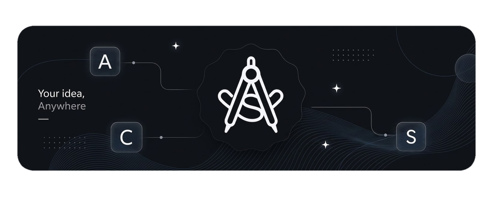

<picture>
  <source media="(prefers-color-scheme: light)" srcset="assets/art/acsart-light.png">
  <source media="(prefers-color-scheme: dark)" srcset="assets/art/acsart-dark.png">
  
</picture>

<h1 align="center">ACSIDE</h1>

  <a href="README.md">English</a> •
  <a href="README.ar.md">العربية</a> •
  <a href="README.ru.md">Русский</a> •
  <a href="README.zh.md">简体中文</a> •
  <a href="README.tr.md">Türkçe</a> •
  <a href="README.es.md">Español</a> •
  <a href="README.he.md">עברית</a> •
  <a href="README.fa.md">فارسی</a> •
  <a href="README.pt-BR.md">Português (Brasil)</a> •
  <a href="README.pt-PT.md">Português (Portugal)</a>

  
  
  

AndroidCS IDE — это полнофункциональная среда разработки для создания и управления проектами Android любого типа прямо на устройстве или на лёгких системах. Она предлагает мощный и в то же время эффективный рабочий процесс для разработчиков, которым нужен полноценный опыт разработки под Android без высоких системных требований традиционных IDE.

<table>
  <tr>
    <td><b>Для кого</b></td>
    <td>Для разработчиков, которым нужна полноценная IDE на Android</td>
  </tr>
  <tr>
    <td><b>Что можно создавать</b></td>
    <td>Приложения Android, библиотеки, приложения Flutter, нативные модули</td>
  </tr>
</table>

---

> [!WARNING]
> **Используйте только официальные загрузки**
>
> Устанавливайте AndroidCS IDE из:
> - **GitHub Release** - https://github.com/AndroidCSIDE/ACSIDE/releases
>
> Не скачивайте APK с неизвестных или неофициальных сайтов — они могут быть изменены или небезопасны.

---

## Поддерживаемые возможности и дорожная карта

### Проекты и сборка
* [x] Поддержка проектов Android Flutter
* [x] Поддержка проектов Gradle
* [x] JDK 17, 21
* [x] SDK Manager для установки инструментов сборки, NDK, CMake, Flutter SDK и другого
* [x] Dependency Updater с уведомлениями об устаревших зависимостях прямо в файлах сборки

### Редактор и поддержка языков
* [x] Подсветка синтаксиса TextMate
* [x] Языковые серверы (каждый можно включать и отключать отдельно):
  * [x] Java Language Server — от [georgewfraser](https://github.com/georgewfraser)
  * [x] Kotlin Language Server — от [nullij](https://github.com/nullij)
  * [x] XML Language Server
  * [x] Dart Language Server *(доступен после установки Flutter SDK)*
  * [x] Python Language Server *(устанавливается через плагины)*
  * [x] Bash Language Server *(устанавливается через плагины)*
  * [x] Clang Language Server *(устанавливается через плагины)*
  * [x] Набор веб-языковых серверов *(устанавливается через плагины)*
* [x] Поддерживаемые возможности LSP:
  * [x] Автодополнение кода
  * [x] Диагностика
  * [x] Всплывающие подсказки (Hover)
  * [x] Подсказки по сигнатурам (Signature Help)
  * [x] Переход к определению
  * [x] Быстрые исправления (Code Actions)
  * [x] Форматирование кода
  * [x] Встроенные подсказки (Inlay Hints)
  * [x] Поддержка Jetpack Compose
* [x] Переключатели функций для каждого сервера: включайте или отключайте отдельные возможности каждого языкового сервера
* [x] Настройка пользовательских параметров JVM для языковых серверов Kotlin и Java

### Предпросмотр
* [x] Реальная система предпросмотра Jetpack Compose
* [x] Реальная система предпросмотра XML-макетов
* [x] Мгновенный предпросмотр приложений Flutter

### Git
* [x] Пошаговый рабочий процесс Git с онбордингом репозитория
* [x] Защищённый менеджер учётных данных с поддержкой нескольких удалённых репозиториев
* [x] Разрешение конфликтов слияния: принять свои изменения, принять чужие или отменить
* [x] Переработанная панель Source Control со встроенным просмотром diff

### ИИ и расширяемость
* [x] ИИ-агент с поддержкой Model Context Protocol (MCP)
* [x] Режим подтверждения правок: просматривайте, принимайте или отклоняйте изменения, предложенные агентом
* [x] Система плагинов

### Терминал и отладка
* [x] Терминал на основе пакетов Termux *(PRoot по-прежнему можно установить через PRoot-Distro)*
* [x] Отладка через ADB с беспроводным сопряжением, поддержкой USB-OTG и logcat через ADB или Shizuku
* [x] Плагин Logger, внедряемый в проекты при отладочных сборках, для более быстрого и надёжного сбора логов

### Персонализация
* [x] Оформление Windows 11 Fluent 2
* [x] Оформление Google Material
* [x] Доступно на английском, арабском, русском, персидском, иврите, турецком и упрощённом китайском языках, и не только...

Другие функции запланированы и будут добавлены позже — следите за новостями!

---

## Ограничения

- AndroidCS IDE (ACSIDE) может не собирать старые проекты, использующие AGP 8.x.x или ниже. Настоятельно рекомендуется обновить проект до последней версии Android Gradle Plugin (AGP) для лучшей совместимости.

---

## 📌 Статус

Проект находится в активной разработке. Отзывы и предложения всегда приветствуются.

### Об исходном коде

В настоящее время исходный код IDE закрыт, что позволяет быстрее вести разработку и выпускать изменения. Когда проект достигнет стабильного состояния, часть исходного кода будет открыта.

### Прозрачность и сетевая конфиденциальность

Исходный код ACSIDE пока закрыт, поэтому вам не нужно верить мне на слово в том, что IDE делает в сети.

- **Никакой телеметрии.** Никакой аналитики, никакого отслеживания использования, никаких скрытых отчётов о сбоях. Если IDE аварийно завершится, вы увидите экран сбоя с кнопкой «Отправить отчёт», которая откроет в браузере предзаполненный issue на GitHub. Ничего не отправляется, пока вы сами этого не сделаете.
- **ИИ-агент:** вы используете собственные API-ключи. Запросы идут напрямую с вашего устройства на выбранный вами сервер модели — от конца до конца — и никогда не проходят через мои серверы.
- **Обновления и плагины** загружаются из открытых репозиториев GitHub: [`updater.json`](https://github.com/AndroidCSIDE/ACSIDE/blob/main/others/updater/updater.json) и [androidcs-plugins](https://github.com/AndroidCSIDE/androidcs-plugins).

Не верьте мне на слово — проверьте: запустите [Reqable](https://reqable.com/) или любой другой монитор сетевого трафика для Android и посмотрите, к каким хостам обращается IDE. Вы должны увидеть только GitHub, репозитории пакетов и SDK, а также настроенного вами ИИ-провайдера. Если вы заметите что-то ещё, пожалуйста, создайте issue.
